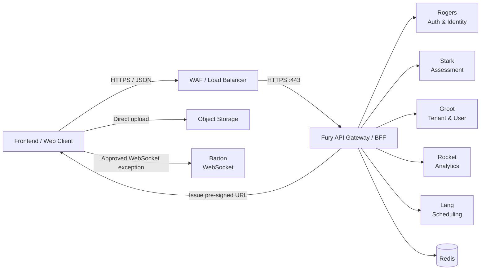
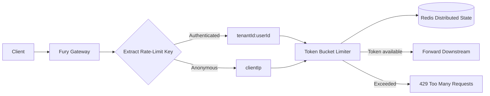
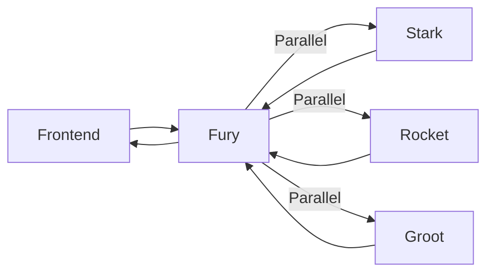
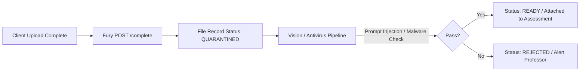
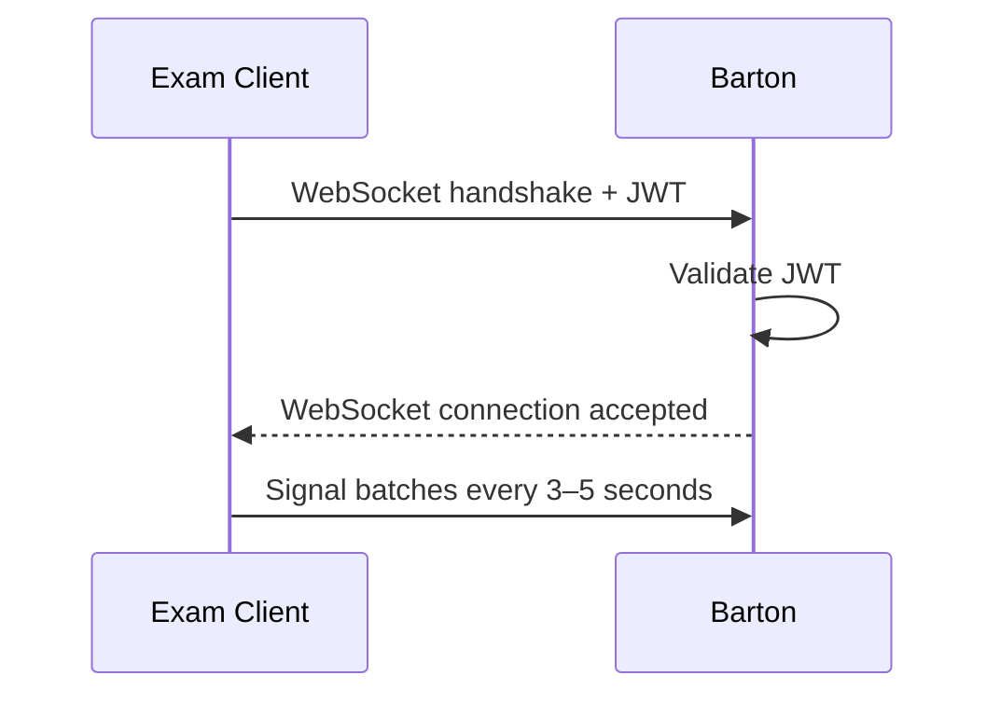
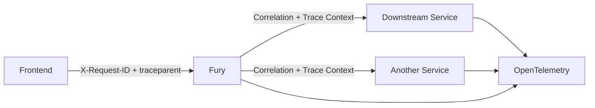
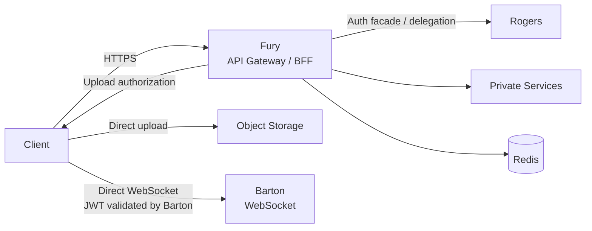

# Fury API Contract

> **Document Type:** API Contract  
> **Service:** Fury — API Gateway / BFF / Base Server  
> **Technology:** Node.js + Fastify 5.x + TypeScript  
> **Status:** Production-hardened Phase 1 architecture finalized; dependency contracts pending

---

## 1. Purpose

This document defines the public API contract and gateway-level API rules for **Fury**, the API Gateway / BFF / Base Server of the RAG Assessment Platform.

Fury is the single public HTTP API entry point. It is responsible for request routing, authentication enforcement, coarse authorization, tenant-context propagation, rate limiting, request correlation, API versioning, response shaping, BFF aggregation, and resilience controls.

Fury does **not** implement business-domain logic. Downstream services remain responsible for business operations, resource-level authorization, persistence, and domain rules.

### 1.1 Phase 1 Boundary

Phase 1 establishes:

1. The public Fury API contract and common conventions.
2. Authentication, authorization, tenancy, idempotency, upload, pagination, rate-limit, error, aggregation, and resilience policies owned by Fury.
3. The dependency-contract requirements for Rogers, Stark, Groot, Rocket, Lang, and storage/file integration.
4. An OpenAPI 3.1 specification based on the finalized public contract and confirmed dependency contracts.

Phase 1 does **not** lock implementation details such as the concrete HTTP client, Redis data structures, middleware/module structure, tracing implementation, or deployment configuration.

---

## 2. API Boundary



**Public exposure:** Fury is the public HTTP API boundary on port 443. Other microservices remain behind the private service boundary.

The two documented frontend communication exceptions are:

- Frontend ↔ Barton for proctoring WebSocket telemetry.
- Frontend ↔ object storage for direct file upload using a pre-signed URL issued through Fury.

---

## 3. API Base Path and Versioning

Public Fury APIs use explicit URL-based major versions:

```text
/api/v1/...
```

Examples:

```http
POST  /api/v1/auth/login
POST  /api/v1/auth/refresh
POST  /api/v1/auth/logout
POST  /api/v1/assessments
PATCH /api/v1/assessments/:id
POST  /api/v1/exams/:id/start
POST  /api/v1/attempts/:id/submit
```

### Versioning Rules

- Breaking API changes require a new major URL version.
- Non-breaking changes remain within the current major version.
- Version lifecycle and deprecation periods are governed by the shared architecture team.

---

# 4. Common Request Conventions

## 4.1 Content Type

JSON is used for normal API request/response payloads unless an endpoint explicitly requires another content type.

## 4.2 Request ID

Fury supports `X-Request-ID` for request-level correlation.

```http
X-Request-ID: req_123
```

Behavior:

- Valid client-provided value → validate and reuse it.
- Missing value → Fury generates one.
- Invalid value → Fury generates a new one.

Validation includes reasonable length and character restrictions and rejects unsafe control characters such as CR/LF.

`X-Request-ID` is a correlation identifier. It is **not** used for authentication or authorization.

## 4.3 Distributed Tracing

Distributed tracing uses W3C Trace Context (`traceparent`) with OpenTelemetry.

Request correlation and distributed tracing are separate concerns:

```text
X-Request-ID
    → Request-level correlation

traceparent / OpenTelemetry
    → Distributed tracing
```

Fury propagates the tracing context to downstream calls.

## 4.4 CORS

CORS enforcement is a Fury responsibility.

## 4.5 Request Validation

Fury validates public request schemas before forwarding requests to downstream services.

Validation failures use the standard error envelope and appropriate HTTP status code, normally `400` or `422` depending on whether the request is malformed or semantically invalid.

---

# 5. Authentication Contract

Fury is the single public API entry point, including the public authentication API surface. Fury exposes authentication routes but does not own authentication business logic.

Rogers remains responsible for:

- Credential validation
- Password handling
- Access-token issuance
- Refresh-token/session management
- Revocation
- Identity lifecycle

## 5.1 Public Authentication Routes

```http
POST /api/v1/auth/login
POST /api/v1/auth/refresh
POST /api/v1/auth/logout
```

Fury delegates these operations to Rogers and normalizes public responses into the Fury response envelope.

The exact Rogers request/response schemas remain part of the Rogers dependency contract.

## 5.2 Login

```http
POST /api/v1/auth/login
```

Fury forwards the login request to Rogers.

Rogers validates credentials and issues authentication tokens. Fury returns the result using the universal response envelope.

Example public response shape:

```json
{
  "success": true,
  "data": {
    "accessToken": "...",
    "refreshToken": "...",
    "expiresIn": 900
  },
  "error": null,
  "meta": {
    "requestId": "req_123"
  }
}
```

The exact token response fields are subject to the Rogers contract.

## 5.3 Refresh

```http
POST /api/v1/auth/refresh
```

The refresh token is carried using a secure HttpOnly cookie.

Expected cookie properties include:

- `HttpOnly`
- `Secure`
- Appropriate `SameSite` policy

Cookie domain, path, expiration, rotation, and revocation behavior must be aligned with Rogers.

Fury forwards the refresh operation to Rogers and returns the normalized result.

## 5.4 Logout

```http
POST /api/v1/auth/logout
```

Fury forwards logout to Rogers. Rogers remains the authoritative owner of session/token revocation.

Fury does not maintain a second authentication-session source of truth.

## 5.5 Protected API Authentication

Protected requests use:

```http
Authorization: Bearer <external-jwt>
```

Fury validates the JWT locally using Rogers JWKS/public keys without synchronously calling Rogers on every request.

To prevent cheating or expelled students flagged mid-exam from retaining access for up to 15 minutes (token expiration window), Fury additionally validates the token against a distributed Redis Bloom filter / pub-sub revocation channel (`token:revoked:<jti>`) with sub-millisecond overhead.

Required validation includes:

- Signature verification against cached Rogers JWKS
- Real-time Redis revocation check (`jti` not blacklisted/flagged)
- Algorithm (`RS256` or `ES256`)
- `exp`
- `iss` (`"rogers"`)
- `aud` (`"fury"`)
- `nbf`, when present
- Required claims
- Role/scope context
- Tenant context

### Required External JWT Claims

```json
{
  "sub": "user-id",
  "tenantId": "tenant-id",
  "role": "PROFESSOR",
  "iat": 123,
  "exp": 456,
  "iss": "rogers",
  "aud": "fury"
}
```

The authoritative Rogers contract remains the source of truth for exact issuer, audience, claim semantics, and token lifetime.

---

# 6. Authorization Contract

Authorization is split between Fury and downstream services.

```text
Client
  ↓
Fury
  ↓
Coarse route-level authorization
  ↓
Downstream Service
  ↓
Resource/business-level authorization
```

### Fury owns

- Route-level role checks.
- Coarse scope checks where applicable.
- Tenant-context enforcement.
- Blocking requests that are not permitted to reach a route.

### Downstream service owns

- Resource ownership.
- Resource-level authorization.
- Business-rule authorization.
- Domain-specific permission checks.

Example:

```text
Fury:
PROFESSOR may call PATCH /assessments/:id

Stark:
Does this professor actually own assessment :id?
```

## 6.1 Role and Scope

Fury uses both role and scopes when required:

```json
{
  "role": "PROFESSOR",
  "scope": [
    "assessment:read",
    "assessment:write"
  ]
}
```

- `role` → coarse RBAC.
- `scope` → fine-grained permission context.

These values are trusted only after successful JWT validation.

Fury does not encode every possible permission into the token.

---

# 7. Multi-Tenancy Contract

Tenant identity is derived from the authenticated JWT.

```json
{
  "sub": "user123",
  "tenantId": "tenant456"
}
```

Fury extracts and trusts `tenantId` only after successful JWT validation and propagates the trusted tenant context to downstream services.

## 7.1 Client-Supplied Tenant IDs

Client-supplied tenant identifiers are not accepted as an authority source.

The following is not permitted as a substitute for JWT tenant context:

```http
X-Tenant-ID: tenant999
```

This prevents clients from selecting or overriding their tenant context directly.

---

# 8. Idempotency Contract

`Idempotency-Key` is required for critical or high-impact mutations where duplicate execution can cause material harm or inconsistent state.

Examples include:

- Exam/assessment submission.
- Attempt finalization.
- Payment operations.
- Critical resource creation.
- Other irreversible or high-impact mutations.

Normal POST requests do not automatically require an idempotency key.

## 8.1 Idempotency Ownership

Idempotency responsibility depends on the endpoint:

```text
Client
  │
  │ Idempotency-Key
  ▼
Fury
  │
  │ Gateway-level duplicate protection
  ▼
Downstream Service
  │
  │ Business-level idempotency
  ▼
Database / Business Operation
```

Fury may use Redis for gateway-level duplicate protection.

The downstream service owns authoritative business idempotency because it owns the business transaction, database state, side effects, and final result.

For critical operations, the downstream service should persist the idempotency key atomically with the business operation where possible.

## 8.2 Reuse Semantics

Same key + same logical request:

```text
→ Return the original logical result
```

Same key + materially different request:

```text
→ 409 Conflict
```

Example:

```json
{
  "success": false,
  "data": null,
  "error": {
    "code": "IDEMPOTENCY_KEY_REUSE",
    "message": "Idempotency-Key was already used with a different request",
    "details": null
  },
  "meta": {
    "requestId": "req_123"
  }
}
```

Exact storage duration and request-fingerprint implementation are implementation-level concerns unless required by a dependency contract.

---

# 9. Pagination Contract

Fury uses **cursor-based pagination** for paginated collection endpoints.

Example:

```http
GET /api/v1/assessments?cursor=<cursor>&limit=20
```

## 9.1 Page Size

```text
Default limit = 20
Maximum limit = 100
```

Behavior:

```text
limit omitted → 20
limit = 50     → 50
limit = 100    → 100
limit > 100    → 400 Bad Request
```

## 9.2 Pagination Metadata

Pagination metadata is returned through the universal `meta` object:

```json
{
  "meta": {
    "requestId": "req_123",
    "nextCursor": "eyJpZCI6...",
    "hasMore": true
  }
}
```

The cursor is opaque to clients. Clients must not construct or modify cursor contents.

---

# 10. Rate Limiting Contract

Rate limiting is owned by Fury and enforced at the API gateway layer.

Redis maintains distributed rate-limit state across horizontally scaled Fury instances.

## 10.1 Rate-Limiting Policy & Campus-NAT Awareness

In college deployments, thousands of concurrent students routinely access exams through shared institutional campus Wi-Fi egress NAT IP pools. A naive IP-based limiter will throttle an entire examination hall upon exam start.

Fury implements a campus-aware multi-tiered policy:

| Request Type | Limit | Primary Key | Notes |
|---|---:|---|---|
| Anonymous / Public | 100 requests/minute | Client IP | Pre-auth endpoints (login, forgot password) |
| Authenticated Standard | 300 requests/minute | `tenantId:userId` | Independent of shared campus NAT IP |
| Exam Start (`/exams/:id/start`) | Burst allowance (50/min) | `userId:examId` | Coordinated with Lang admission queuing |
| Exam Submission (`/attempts/:id/submit`) | 10 requests/minute | `userId:attemptId` | Strict double-click protection |

The policy may additionally use tenant, endpoint, user, and device fingerprint context where required by production abuse controls.

## 10.2 Algorithm

Fury uses a **token bucket** rate-limiting model backed by Redis with atomic Lua scripts.



## 10.3 Rate-Limit Response

When a request exceeds its applicable limit, Fury returns `429 Too Many Requests` and does not forward the request downstream.

```json
{
  "success": false,
  "data": null,
  "error": {
    "code": "RATE_LIMIT_EXCEEDED",
    "message": "Too many requests. Please slow down.",
    "details": {
      "retryAfterSeconds": 30
    }
  },
  "meta": {
    "requestId": "req_123"
  }
}
```

## 10.4 Redis Failure Policy

Redis failure employs a resilient tiered fallback strategy:

```text
Redis Unavailable / Degraded
      │
      ├── Standard Read / Query Endpoints
      │       ↓
      │   Fail OPEN (log warning & emit P1 alert)
      │
      ├── Administrative / Sensitive Auth Endpoints
      │       ↓
      │   Fail CLOSED (protect security boundary)
      │
      └── CRITICAL EXAM SUBMISSION ENDPOINTS (/attempts/:id/submit)
              ↓
          Fail OPEN TO DOWNSTREAM (Stark / DB)
          (Never drop student exam submissions; Stark transactional DB
           enforces compound unique index on attemptId + idempotencyKey)
```

> [!CRITICAL]
> **Zero Exam Drop Guarantee:** Live student exam submissions must **never** fail closed on gateway infrastructure outages. If the gateway-level Redis cache is down, the submission is forwarded directly to Stark with its `Idempotency-Key`. Stark's MongoDB compound index `(attemptId, idempotencyKey)` guarantees transactional deduplication and data persistence. Fail-open events must be logged with high-priority alerting.

---

# 11. Universal Response Contract

All public Fury HTTP endpoints use the same response envelope unless an endpoint explicitly requires a protocol-specific response.

## 11.1 Success

```json
{
  "success": true,
  "data": {},
  "error": null,
  "meta": {
    "requestId": "req_123"
  }
}
```

## 11.2 Error

```json
{
  "success": false,
  "data": null,
  "error": {
    "code": "ASSESSMENT_NOT_FOUND",
    "message": "Assessment not found",
    "details": null
  },
  "meta": {
    "requestId": "req_123"
  }
}
```

### Error fields

- `code` → machine-readable error identifier.
- `message` → human-readable description.
- `details` → optional structured error context.
- `data` → `null` for error responses.
- `meta.requestId` → request correlation identifier.

## 11.3 Downstream Error Mapping

Fury uses hybrid error-code ownership.

### Fury-owned gateway errors

Examples:

```text
AUTH_TOKEN_INVALID
AUTH_TOKEN_EXPIRED
FORBIDDEN
VALIDATION_FAILED
RATE_LIMIT_EXCEEDED
DOWNSTREAM_TIMEOUT
DOWNSTREAM_UNAVAILABLE
```

### Downstream-owned domain errors

Examples:

```text
ASSESSMENT_NOT_FOUND
ASSESSMENT_LOCKED
ATTEMPT_ALREADY_SUBMITTED
```

Fury preserves downstream domain `code` and `message` where appropriate while wrapping them in the universal Fury envelope.

Fury owns transport-level normalization. It does not rewrite domain semantics into gateway-specific business logic.

---

# 12. HTTP Status Contract

Fury supports the following standard HTTP statuses:

| Status | Meaning / Typical usage |
|---|---|
| `200 OK` | Successful synchronous operation |
| `201 Created` | Synchronous resource creation |
| `202 Accepted` | Request accepted for asynchronous processing |
| `204 No Content` | Successful operation with no response body |
| `400 Bad Request` | Malformed or structurally invalid request |
| `401 Unauthorized` | Missing, invalid, or expired authentication |
| `403 Forbidden` | Authenticated but not permitted for the route |
| `404 Not Found` | Requested resource/route not found |
| `409 Conflict` | State conflict or idempotency-key conflict |
| `422 Unprocessable Entity` | Valid request structure but semantic/validation failure |
| `429 Too Many Requests` | Rate limit exceeded |
| `500 Internal Server Error` | Unexpected Fury-side failure |
| `502 Bad Gateway` | Invalid/unusable downstream response or gateway dependency failure |
| `503 Service Unavailable` | Downstream/service unavailable or circuit open |
| `504 Gateway Timeout` | Downstream operation exceeded its gateway timeout |

### 12.1 400 vs 422

```text
400 → malformed/structurally invalid request
422 → syntactically valid request that fails semantic validation/business validation
```

Endpoint-specific contracts determine which applicable status is returned.

---

# 13. Endpoint Contracts

This section defines the public endpoint inventory and the currently finalized gateway-level behavior. Exact business request/response schemas that belong to downstream services remain pending their authoritative contracts.

## 13.1 Create Assessment

```http
POST /api/v1/assessments
```

### Purpose

Creates an assessment draft through Stark.

### Authentication

JWT required.

### Authorization

Fury requires the appropriate professor route-level permission. Stark remains responsible for resource/business authorization.

### Response

```text
202 Accepted
```

The documented flow identifies:

```text
assessmentId
jobId
```

The exact request body and response schema must be confirmed from Stark before OpenAPI is finalized.

### Idempotency

If the operation is classified as a critical mutation, `Idempotency-Key` is required.

---

## 13.2 Update Assessment

```http
PATCH /api/v1/assessments/:id
```

### Purpose

Updates an existing assessment. The documented example is professor approval of an assessment.

### Authentication

JWT required.

### Authorization

Fury performs coarse route-level authorization. Stark performs resource ownership and business-rule authorization.

### Request / Response

The exact request and response schemas must be confirmed from Stark.

---

## 13.3 Start Exam

```http
POST /api/v1/exams/:id/start
```

### Purpose

Starts an exam attempt/session and acquires question payload with proctoring baseline configuration.

### Authentication

JWT required (student role).

### Downstream Orchestration (Thundering-Herd Protection)

Lang handles scheduling and session orchestration. During mass-start events (e.g. 5,000 students starting at 10:00:00 AM):
- Lang admits students in staggered batches (e.g. 50-100 every 500ms).
- Fury holds connection or issues a temporary admission ticket with an exponential polling interval to avoid HTTP connection resets and socket starvation.

### Response

```text
200 OK
{
  "success": true,
  "data": {
    "attemptId": "att_123",
    "sessionToken": "ses_456",
    "proctoringConfig": {
      "telemetryIntervalMs": 3000,
      "bartonWsUrl": "wss://barton.assessverse.io/telemetry"
    },
    "questions": [...]
  },
  "error": null,
  "meta": {
    "requestId": "req_123"
  }
}
```

---

## 13.4 Submit Attempt

```http
POST /api/v1/attempts/:id/submit
```

### Purpose

Submits a student's finalized exam attempt into the asynchronous grading workflow.

### Authentication

JWT required.

### Idempotency & Conflict Resolution

- **Mandatory Header:** `Idempotency-Key: <uuid-v4>`
- **Double-Click & Replay Protection:** Fury checks gateway Redis key `idemp:submit:<attemptId>`.
- **Manual vs. Timer Auto-Submit Race Condition:**
  - If a student manually submits at 10:59:59 while Lang triggers timer auto-submission at 11:00:00, Stark resolves the race condition in MongoDB using an atomic conditional update (`findOneAndUpdate({ _id: attemptId, status: "IN_PROGRESS" }, { $set: { status: "SUBMITTED" } })`).
  - Whichever arrives first wins; the second receives the original confirmed submission receipt rather than an error or duplicate grading job.
- **Client Offline-Sync Protocol:** If an institutional network drop occurs during submission, the client exam shell retains the encrypted submission payload in local IndexedDB and retries with the same `Idempotency-Key` once connectivity resumes.

### Fail-Open Policy

If Redis is down, Fury forwards the submission directly to Stark. Stark's database-level unique compound index on `(attemptId, idempotencyKey)` guarantees that no student exam submission is ever lost.

---

# 14. BFF Aggregation Contract

Fury may expose aggregated endpoints when a frontend view genuinely requires data from multiple services.

## 14.1 Dashboard

A documented aggregation example combines:

- Stark → assessment data
- Rocket → analytics
- Groot → profile data

A public dashboard route may be exposed as:

```http
GET /api/v1/dashboard
```

The exact endpoint name and response schema are part of the public contract and must be confirmed before OpenAPI finalization.

### Aggregation Flow



## 14.2 Partial Failure

For non-critical dashboard dependencies, Fury may return a partial response with warnings.

Example:

```json
{
  "success": true,
  "data": {
    "profile": {},
    "assessments": [],
    "analytics": null
  },
  "error": null,
  "meta": {
    "requestId": "req_123",
    "partial": true,
    "failedServices": ["rocket"]
  }
}
```

Critical dependency failures may fail the entire aggregation.

The classification of critical versus non-critical dependencies is endpoint-specific configuration.

## 14.3 Aggregation Timeouts

Timeouts are endpoint-specific configuration values.

Illustrative configuration:

```text
Groot  → 2s
Stark  → 3s
Rocket → 2s
```

These values are examples of configurable policy, not hard-coded contract constants.

---

# 15. File Upload Contract

File uploads are a documented exception to the normal frontend → Fury → downstream flow.

Fury exposes the public upload authorization endpoint while actual file bytes bypass Fury and go directly to object storage.

## 15.1 Request Upload URL

```http
POST /api/v1/files/upload-url
```

### Pre-Signed URL Anti-Abuse Constraints

To eliminate MIME-spoofing, prompt-injection injection payloads, and storage exhaustion attacks:
1. **Header-Enforced IAM Signatures:** The pre-signed `PUT` URL cryptographically enforces:
   - `Content-Type`: Exactly matches the validated `contentType` (e.g. `application/pdf`). S3 rejects the upload if any other Content-Type is sent.
   - `content-length-range`: Restricted to `[1, declaredSize]`. Any oversized file upload is immediately rejected at the S3 edge.
   - `x-amz-checksum-sha256`: Optional client-provided checksum validated during the upload stream.
2. **Path Namespace Isolation:** Upload paths are strictly server-generated by Fury / Storage Service using the template: `tenants/{tenantId}/{purpose}/{fileId}/{fileName}`. Client-supplied paths or directory traversal characters are rejected.

### Response

```json
{
  "success": true,
  "data": {
    "fileId": "fil_abc123",
    "uploadUrl": "https://storage.assessverse.io/assessverse-quarantine/tenants/t_123/...?X-Amz-Signature=...",
    "expiresIn": 600,
    "requiredHeaders": {
      "Content-Type": "application/pdf"
    }
  },
  "error": null,
  "meta": {
    "requestId": "req_123"
  }
}
```

## 15.2 Pre-Signed URL TTL

```text
Default expiration = 10 minutes (configurable per purpose)
```

## 15.3 Direct Upload

```text
Frontend
   │
   │ Direct PUT with signed headers
   ▼
Object Storage (Quarantine Bucket)
```

Fury does not proxy the file bytes.

## 15.4 Upload Completion & Quarantine Workflow

After successful upload:

```http
POST /api/v1/files/:fileId/complete
```

Fury verifies:
- Object existence and exact length in storage.
- Associated tenant and user ownership.
- Transitions status to `QUARANTINED`.



Files are **not attached or viewable** until Vision's prompt-injection sanitization and antivirus scans confirm the file is clean.

---

# 16. Barton WebSocket Exception

Proctoring telemetry uses a direct WebSocket connection between the exam client and Barton.



This is outside Fury's normal HTTP routing path.

Barton is responsible for validating the WebSocket authentication context according to the Barton contract.

---

# 17. Downstream Communication Contract

Fury communicates with private services through an internal service-to-service security boundary.

## 17.1 Internal Authentication

Fury does not forward the external client JWT to downstream services.

Instead:

```text
Client
   │ External JWT
   ▼
Fury
   │
   ├── Validate using Rogers JWKS
   ├── Extract trusted identity/tenant/authorization context
   └── Issue short-lived internal signed JWT
          │
          ▼
Downstream Service
```

mTLS and internal JWT have separate responsibilities:

```text
mTLS → Which service is calling?
JWT  → On whose behalf?
```

## 17.2 Internal JWT Claims

Required internal claims:

```json
{
  "sub": "user-id",
  "tenantId": "tenant-id",
  "role": "PROFESSOR",
  "source": "fury",
  "aud": "stark",
  "iat": 123,
  "exp": 456,
  "jti": "internal-token-id"
}
```

Optional:

```json
{
  "scope": [
    "assessment:read",
    "assessment:write"
  ]
}
```

Claims should contain only the context required by the receiving service. Fury should not put every permission into the internal token.

## 17.3 Service Discovery

Initial service discovery uses Kubernetes/DNS service discovery.

Example:

```text
http://stark:8080
http://groot:8080
http://rocket:8080
```

A separate service registry is not required initially.

## 17.4 HTTP Client

The concrete HTTP client is intentionally **TBD**.

The downstream communication abstraction must support:

- Timeouts
- Retry policy
- Circuit breakers
- Request/response handling
- Distributed tracing

---

# 18. Resilience Contract

## 18.1 Retry Policy

Retries are endpoint-dependent.

Potential retry conditions include:

- Connection failures.
- `502 Bad Gateway` where the failure is transient.
- `503 Service Unavailable`.
- Some `504 Gateway Timeout` cases.

Fury must not blindly retry non-idempotent mutations.

Example:

```text
GET /assessments
→ Retry may be allowed

POST /attempts/:id/submit
→ No automatic retry unless explicitly idempotent
```

Retries must respect endpoint idempotency guarantees.

## 18.2 Retry Count

Maximum retry count:

```text
1 original attempt
+
2 retries
=
3 maximum total attempts
```

Retries use exponential backoff with jitter. Exact delay values remain configurable.

## 18.3 Circuit Breakers

Fury uses a separate circuit breaker per downstream service.

```text
Fury → Stark circuit
Fury → Groot circuit
Fury → Rocket circuit
Fury → Lang circuit
```

An unhealthy dependency can be isolated without automatically stopping traffic to healthy dependencies.

## 18.4 Failure Mapping

Typical gateway outcomes include:

```text
Downstream timeout → 504 Gateway Timeout
Downstream unavailable / circuit open → 503 Service Unavailable
Invalid/unusable downstream response → 502 Bad Gateway
Unexpected Fury failure → 500 Internal Server Error
```

Endpoint-specific dependency contracts may refine these mappings.

---

# 19. JWKS / Key Management Contract

Rogers is the JWT issuer and publishes the public keys required for Fury to validate external access tokens.

## 19.1 Local JWKS Cache

Fury uses a local in-memory/cache representation of Rogers JWKS.

Redis is **not** the primary JWKS cache (public keys are cached in-memory per Fury instance).

Redis is used for distributed gateway state:
- Rate-limit counters.
- Gateway-level idempotency keys.
- **Real-Time Token Revocation Bloom Filter & Pub/Sub (`token:revoked:<jti>`)**.

## 19.2 Real-Time Token Revocation Lifecycle (Mid-Exam Fraud)

To solve the production vulnerability where cheating or expelled students retain access for up to 15 minutes under purely stateless JWT validation:
1. When **Barton** flags severe cheating or a professor invalidates an attempt, **Rogers** marks the session revoked in `auth_db`.
2. Rogers publishes an invalidation event to Redis (`token:revoked:<jti>`) and adds the `jti` to the distributed revocation Bloom filter with TTL equal to the token's remaining lifetime.
3. All running Fury instances receive the pub/sub event, update their local hot revocation cache in `<1ms`, and immediately reject subsequent requests from that token with `401 Unauthorized (TOKEN_REVOKED)`.

## 19.3 Unknown `kid`

If a token contains an unknown key ID:

```text
JWT
 │
 ├── kid exists locally?
 │        │
 │       YES
 │        ↓
 │     Validate
 │
 └── NO
       ↓
  Refresh JWKS once
       ↓
  Retry validation
       │
       ├── kid found → Validate
       └── still unknown → Reject
```

JWKS refresh must be bounded/rate-limited to avoid attacker-induced refresh storms. A single-flight or equivalent mechanism should prevent redundant simultaneous refreshes.

## 19.4 Rogers Unavailable

If Rogers is unavailable but Fury already has the required trusted public key, Fury continues local JWT validation.

The JWT must still pass normal validation.

Cached-key freshness and refresh policy must be defined so keys are not trusted indefinitely.

---

# 20. Request / Response Tracing

Fury propagates request correlation and distributed tracing context through downstream requests.



The public correlation identifier is `X-Request-ID`.

Distributed tracing uses `traceparent` / OpenTelemetry.

---

# 21. API Contract Ownership

The shared architecture team governs the public Fury API contract.

Responsibilities include:

- API standards.
- Naming conventions.
- Universal response envelope.
- Error contract.
- Versioning standards.
- Pagination standards.
- Breaking-change governance.

The Fury team implements and maintains the gateway contract.

Downstream service teams own their internal service contracts.

```text
Shared Architecture Team
          │
          │ Public API governance
          ▼
       Fury Team
          │
          │ Public API
          ▼
  Private downstream services
```

---

# 22. Dependency Contract Matrix

The public Fury contract is finalized at the architecture-decision level, but authoritative dependency contracts are still required before the complete OpenAPI specification can be considered implementation-ready.

Fury must obtain or confirm the following from service owners.

| Dependency | Required contract information | Status |
|---|---|---|
| **Rogers** | Login, refresh, logout, JWKS, issuer/audience, claims, token lifetime, rotation, errors | Pending |
| **Stark** | Assessment APIs, attempt APIs, request/response schemas, errors, authorization, tenancy, idempotency | Pending |
| **Groot** | User/profile/tenant APIs, schemas, errors, authorization, tenancy | Pending |
| **Rocket** | Analytics APIs, schemas, errors, authorization, tenancy | Pending |
| **Lang** | Exam-start/scheduling APIs, schemas, errors, flash-crowd behavior | Pending |
| **Storage/File Service** | Upload URL, completion, file lifecycle, TTL, metadata validation | Pending |
| **Barton** | WebSocket authentication and telemetry contract | Pending / separate WebSocket contract |

Fury must not invent downstream request/response schemas where an authoritative service contract exists.

---

# 23. OpenAPI 3.1

The implementation contract will be represented in two complementary artifacts:

```text
FuryAPIContract.md
        │
        │ Human-readable rules,
        │ decisions, rationale
        ▼
OpenAPI 3.1
        │
        ├── Swagger UI
        ├── Request/response validation
        ├── Generated clients
        └── Machine-readable API contract
```

OpenAPI should be finalized only after the public endpoint schemas and required downstream dependency contracts are confirmed.

---

# 24. Phase 1 Completion Status

### Finalized & Hardened for Production

- Public Fury API boundary (Node.js + Fastify 5.x + TypeScript).
- URL-based API versioning.
- Universal response envelope.
- HTTP status matrix.
- Authentication route ownership.
- Local JWT validation using Rogers JWKS.
- Local JWKS caching with single-flight unknown-`kid` refresh.
- Real-time Redis token revocation filter/pub-sub for mid-exam cheat flags.
- Role + scope authorization model.
- Fury + downstream authorization split.
- JWT-derived tenant isolation (ignoring client-supplied `X-Tenant-ID`).
- Critical-mutation idempotency policy.
- Zero-drop exam submission fail-open to Stark/DB policy.
- Campus-NAT aware token-bucket rate limiting.
- Cursor pagination & limits.
- Redis rate-limit state & tiered failure policies.
- Hybrid gateway/domain error-code ownership.
- BFF aggregation and partial-failure behavior.
- Endpoint-specific aggregation timeout policy.
- Internal signed JWT model (short-lived 2 min TTL + mTLS).
- Kubernetes/DNS service discovery.
- Endpoint-dependent retries with exponential backoff & jitter.
- Multi-replica coordinated circuit breakers.
- Public authentication response normalization.
- HttpOnly refresh-cookie approach.
- Rogers-owned logout/revocation.
- Upload authorization endpoint and direct-upload model with MIME/size-range enforcement.
- S3 upload completion & Vision/antivirus quarantine workflow.
- `X-Request-ID` correlation behavior.
- `traceparent` / OpenTelemetry distributed tracing.
- Shared architecture governance of the public API.
- OpenAPI 3.1 + Markdown contract strategy.

### Pending dependency inputs

- Exact Rogers authentication schemas and JWKS details.
- Exact Stark request/response schemas.
- Exact Groot request/response schemas.
- Exact Rocket request/response schemas.
- Exact Lang request/response schemas.
- Exact storage/file-service schemas.
- Barton WebSocket contract.
- Final endpoint-specific retry/timeout values where dependency requirements affect them.

Therefore, **Fury's architecture-level Phase 1 decisions are finalized, but the implementation-ready dependency-contract package is not yet complete.**

---

# 25. Summary

Fury establishes a controlled public API boundary over the private microservice architecture.



The architectural boundary is:

```text
Fury owns:
Public API boundary
Authentication enforcement
Coarse authorization
Tenant context
Rate limiting
Request correlation
Tracing propagation
Routing
BFF aggregation
Response shaping
Resilience controls

Rogers owns:
Authentication lifecycle
Credential validation
Token issuance
Refresh/session lifecycle
Revocation
Identity lifecycle

Downstream services own:
Business logic
Resource-level authorization
Persistence
Domain state
Business-level idempotency
Internal service contracts

Shared Architecture Team owns:
Public API governance
Breaking-change governance
API standards
```
