# Fury Architecture

## 1. Overview

Fury is the **API Gateway / BFF (Backend for Frontend) / Base Server** of the RAG Assessment Platform.

Its primary purpose is to act as the **single public API entry point** for the frontend and to handle gateway-level concerns before requests reach internal services.

Fury is intentionally **stateless, lean, and free of business logic**. It routes requests, enforces gateway-level security and traffic policies, coordinates requests to internal services when required, and shapes the response returned to the frontend.

### Core characteristics

| Attribute | Detail |
|---|---|
| Role | API Gateway / BFF / Base Server |
| Technology | Node.js + Fastify 5.x + TypeScript |
| Public Port | 443 |
| State | Stateless |
| Persistent Database | None |
| Supporting Store | Redis (Rate limits, revocation cache, token validation cache) |
| Communication | Synchronous request/response for immediate frontend requests |
| Public API Boundary | Fury |

---

## 2. Scope

This document describes the architecture of **Fury itself**.

It covers:

- Fury's responsibilities
- Fury's boundaries
- Request lifecycle
- Authentication enforcement
- Routing
- BFF aggregation
- Rate limiting
- Resilience
- Request tracing
- Response shaping
- API versioning
- CORS and compression
- State and Redis usage
- Security boundary
- Scalability
- Key request flows
- Fury's dependencies

The architecture of the overall platform and the internal implementation of other microservices are intentionally outside the scope of this document.

---

## 3. Goals

Fury is designed to:

1. Provide a single public API entry point.
2. Keep frontend clients independent of internal service locations.
3. Enforce authentication before forwarding authenticated requests.
4. Apply gateway-level traffic controls such as rate limiting.
5. Route requests to the appropriate internal service.
6. Aggregate responses when a frontend operation requires data from multiple services.
7. Prevent failures in one downstream service from unnecessarily cascading through Fury.
8. Provide consistent request tracing and response handling.
9. Keep gateway logic separate from business logic.
10. Scale horizontally as request traffic increases.

---

## 4. Non-Goals

Fury does **not** own or implement business-domain logic.

Fury should not:

- Manage assessment business rules.
- Manage users or tenants as a domain service.
- Generate questions.
- Grade submissions.
- Perform AI/RAG processing.
- Execute untrusted code.
- Implement scheduling business logic.
- Own business-domain persistence.
- Access another service's database directly.
- Replace the responsibility of downstream domain services.

If a request requires business behavior, Fury forwards or coordinates the request with the service responsible for that behavior.

---

## 5. Position in the Request Architecture

The frontend communicates with Fury as the primary API boundary.

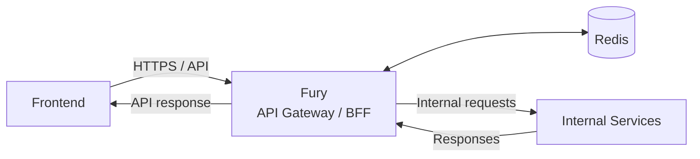

Fury is the public-facing service. Internal services are behind the gateway boundary.

The architecture proposal permits two documented exceptions to the general frontend-to-Fury rule:

- Proctoring telemetry uses a direct WebSocket connection to Barton.
- Object-storage uploads use pre-signed URLs issued by Fury.

These exceptions are not part of Fury's normal HTTP request-routing path.

### Detailed Fury HLD Diagram

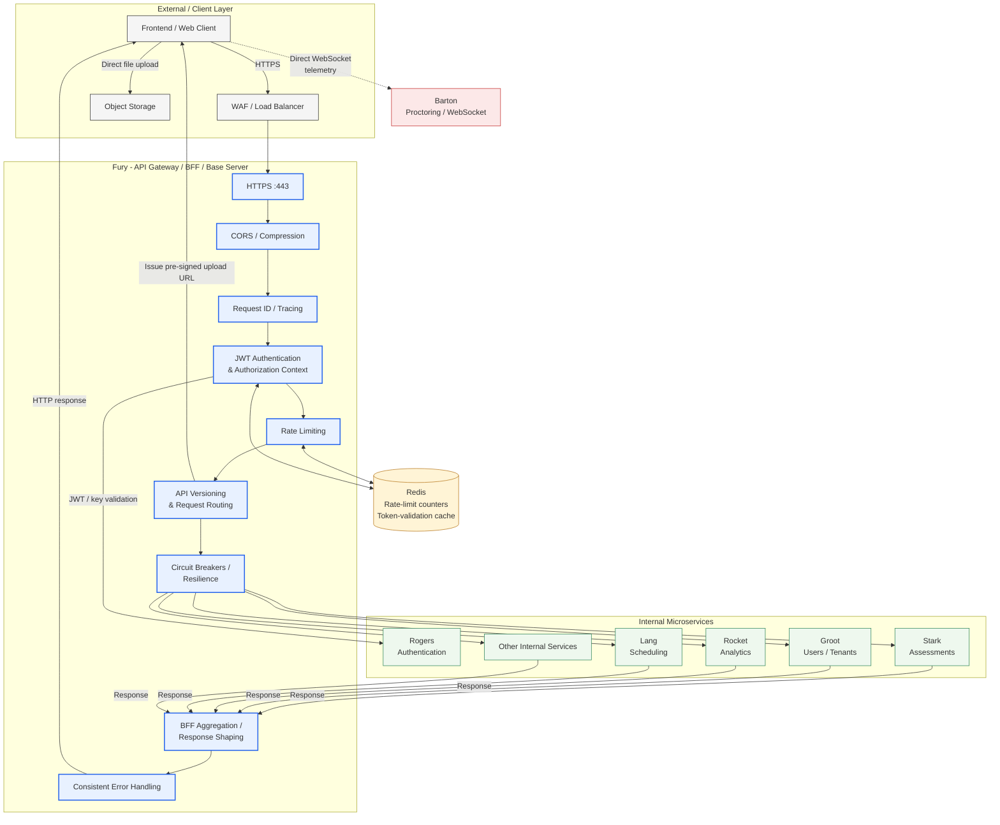

The diagram shows Fury's HLD boundary and the major responsibilities that participate in the request path. It intentionally represents internal services as dependency endpoints rather than describing their internal architecture.

---

## 6. High-Level Fury Architecture

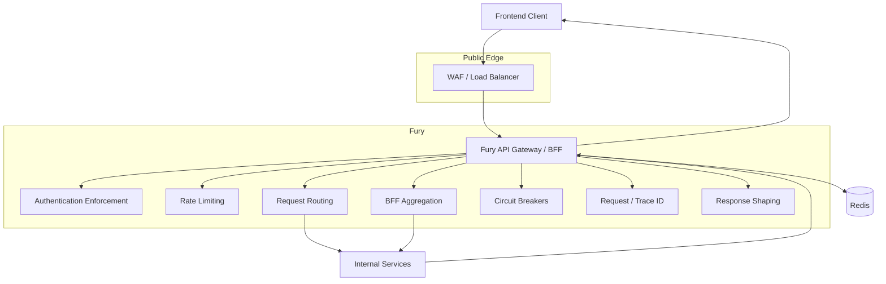

The individual components above represent **logical responsibilities within Fury**, not necessarily separate deployable services.

---

## 7. Fury Responsibilities

### 7.1 Request Routing

Fury determines which internal service should receive a request.

Example:

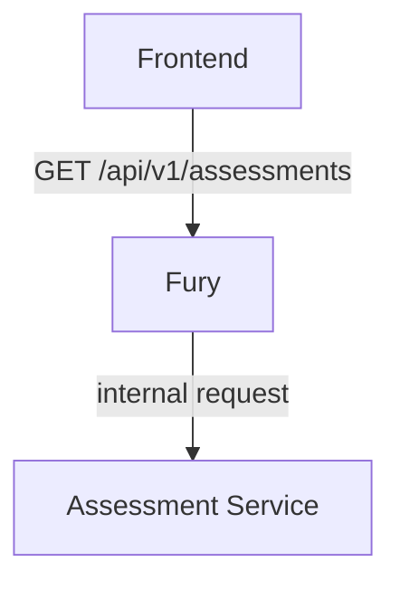

The frontend does not need to know the internal service address.

---

### 7.2 Authentication Enforcement

Authenticated requests pass through Fury's authentication middleware.

The architecture specifies asymmetric JWT validation using Rogers' public keys (JWKS) cached in memory. To solve the critical production edge case where a student is flagged for cheating or expelled mid-exam (which cannot wait for 15-minute token expiration), Fury cross-references a distributed revocation Bloom filter or pub/sub blacklist channel in Redis (`token:revoked:<jti>`) with sub-millisecond lookup latency before forwarding requests.

Conceptually:

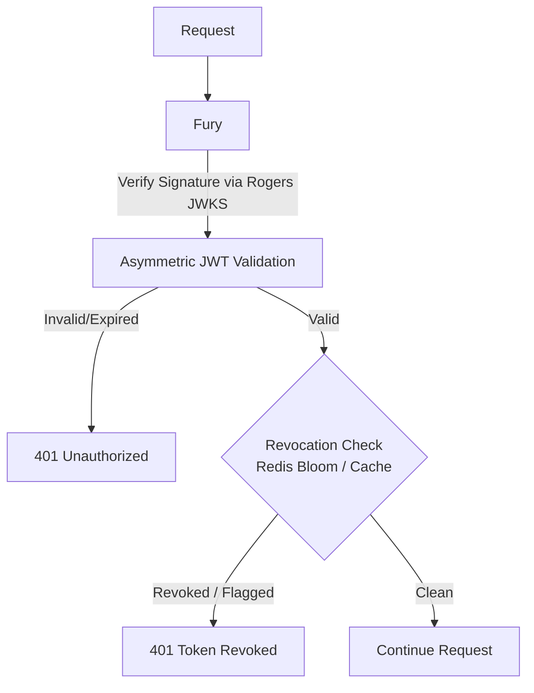

Fury's responsibility is to enforce the authentication boundary and immediate revocation propagation. The identity and session lifecycle remains with Rogers.

---

### 7.3 Rate Limiting & Flash-Crowd Management

Fury applies rate limiting at the gateway layer using Redis-backed token buckets.

#### Campus NAT Awareness
In high-stakes academic deployments, thousands of concurrent students frequently take exams from a single college campus Wi-Fi network sharing a small pool of egress NAT public IPs. Enforcing naive IP-based rate limiting immediately causes catastrophic false-positive `429 Too Many Requests` rejections for entire exam halls.

Fury resolves this with a multi-tiered rate limiting strategy:
1. **Anonymous / Pre-Auth Routes:** Keyed by client IP with high burst ceilings and WAF integration.
2. **Authenticated Routes:** Keyed strictly by `(tenantId, userId)` rather than IP.
3. **Exam Start Route (`/exams/:id/start`):** Special admission policy coordinating with Lang to protect against socket pool exhaustion during 10:00 AM thundering herds.

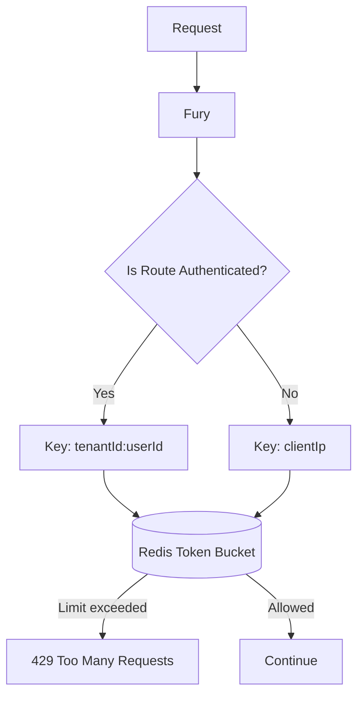

---

### 7.4 BFF Response Aggregation

Some frontend operations require data from multiple internal services.

Instead of requiring the frontend to make several requests, Fury can fan out internal requests and combine their responses.

Example:

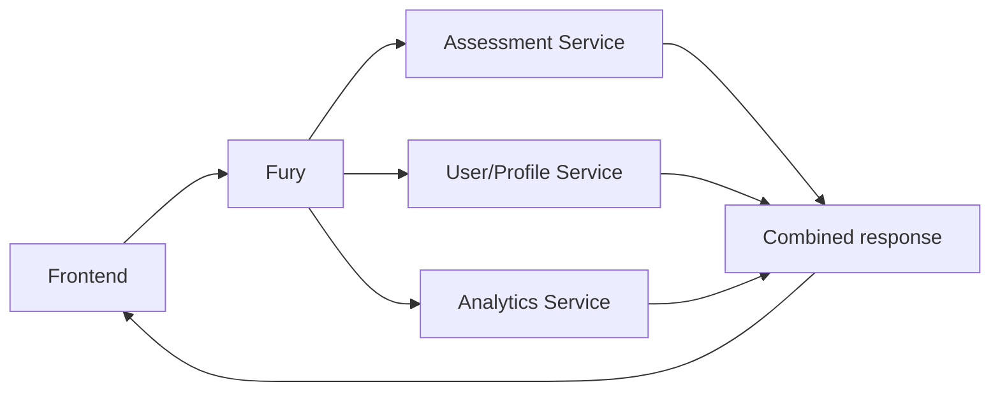

This is one of Fury's primary BFF responsibilities.

---

### 7.5 Request ID and Distributed Tracing

Fury injects a trace/correlation ID into downstream requests.

The architecture specifies an `X-Trace-ID` associated with OpenTelemetry tracing.

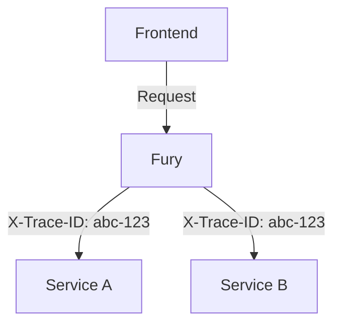

This allows a request to be correlated across Fury and downstream services.

---

### 7.6 Response Shaping

Fury can transform or combine downstream responses into the API response expected by the frontend.

The downstream service remains responsible for its own business data. Fury is responsible only for the gateway/BFF-level response representation.

---

### 7.7 API Versioning

Fury provides the public API version boundary.

Example:

```text
/api/v1/assessments
/api/v1/dashboard
```

Versioning at the gateway prevents internal service details from being exposed directly to clients.

---

### 7.8 CORS

Fury enforces CORS for the public API boundary.

This keeps browser-origin policy at the gateway instead of requiring every internal service to independently handle frontend CORS configuration.

---

### 7.9 Compression

Fury can apply response compression at the public API boundary where appropriate.

---

## 8. Request Lifecycle

A normal authenticated request follows this high-level lifecycle:

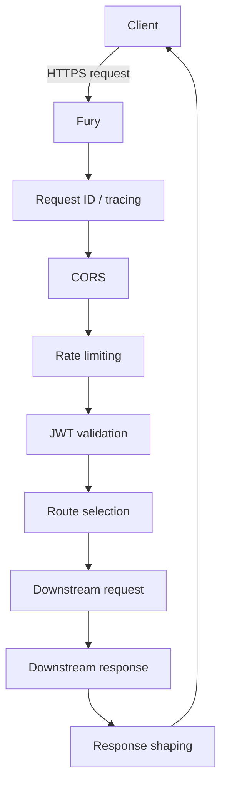

Fury should remain focused on these gateway concerns and should not insert domain-specific business decisions into this pipeline.

---

## 9. Concrete Request Flow: Dashboard

A dashboard request is an example of Fury acting as a BFF.

### Request

```http
GET /api/v1/dashboard
Authorization: Bearer <JWT>
```

### Sequence

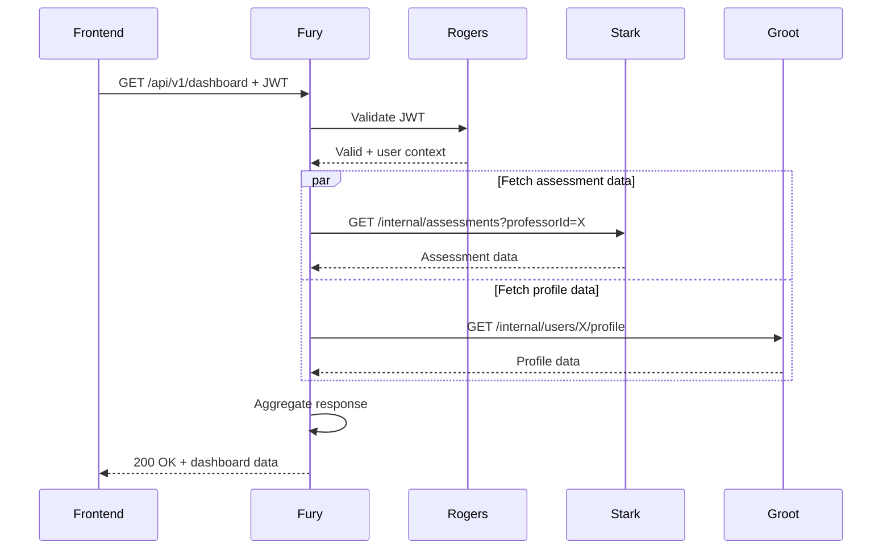

### Flow explanation

1. The frontend sends the dashboard request to Fury.
2. Fury validates the JWT through the authentication mechanism defined by the architecture.
3. Fury identifies the internal data required for the dashboard.
4. Fury requests assessment data.
5. Fury requests profile data.
6. Responses return to Fury.
7. Fury aggregates the data.
8. Fury sends one unified dashboard response to the frontend.

The architecture proposal explicitly describes this dashboard fan-out pattern.

---

## 10. Downstream Communication

Fury communicates with internal services for request/response operations that require an immediate answer.

Conceptually:

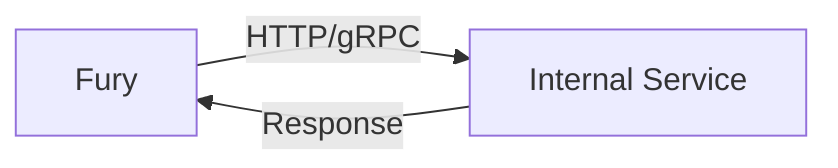

The architecture proposal identifies synchronous internal communication for immediate request/response operations.

The exact internal protocol, such as HTTP or gRPC, should be finalized as an implementation/architecture decision if not already fixed.

---

## 11. Resilience

Fury uses circuit breakers around downstream calls to isolate failing internal services and prevent cascading collapses.

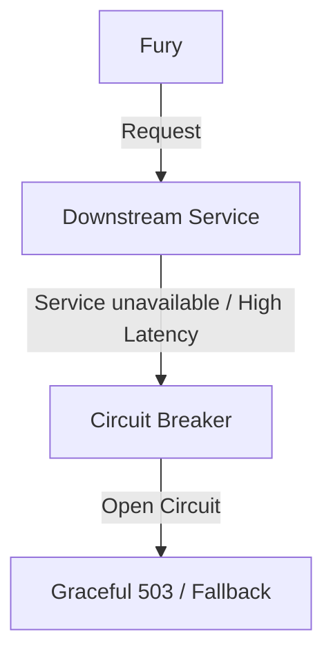

### Multi-Replica Circuit Breaker Coordination
When Fury is horizontally scaled (3–10+ pods), standalone in-memory circuit breakers (e.g., Opossum) can cause a **thundering probe effect** when a downstream service recovers, as every pod independently tests the recovering service. In production:
- Pods synchronize breaker trip counts or threshold breaches via Redis, or circuit breaking is delegated to an ingress Service Mesh (Envoy / Istio).
- Probe requests in the `HALF-OPEN` state are rate-limited across replicas.

### Critical Path Submission Resilience
For live exam submissions (`POST /api/v1/attempts/:id/submit`), circuit breaking must never prematurely drop student work:
- Timeouts on submission paths are elevated (e.g., 15s) with controlled retry policies.
- If gateway-level circuit breakers are tripped or Redis is degraded, Fury routes submissions to a high-priority fallback ingestion path / transactional store with dead-letter buffering rather than discarding submissions with a generic 503.

### Resilience Responsibilities
- Downstream timeouts per service tier
- Multi-replica coordinated circuit breakers
- Controlled error responses preserving domain codes
- Fallback degradation for non-critical BFF endpoints (e.g., dashboard returns partial profile without analytics)
- Strict retry safety (only idempotent requests retried with exponential backoff and jitter)

---

## 12. Error Handling

Fury should expose a consistent API-facing error format rather than leaking raw downstream errors.

Conceptually:

```json
{
  "error": {
    "code": "SERVICE_UNAVAILABLE",
    "message": "The requested service is temporarily unavailable",
    "traceId": "abc-123"
  }
}
```

The exact error schema should be standardized as part of the API contract.

Typical gateway-level responses include:

| Status | Meaning |
|---|---|
| 400 | Invalid request |
| 401 | Authentication failure |
| 403 | Authorization failure |
| 404 | Route/resource not available |
| 429 | Rate limit exceeded |
| 502 | Invalid/unexpected downstream response |
| 503 | Downstream service unavailable |
| 504 | Downstream timeout |

The precise mapping of downstream errors to these responses should be defined in the API/error contract.

---

## 13. State Management

Fury is stateless and does not own a persistent business database.

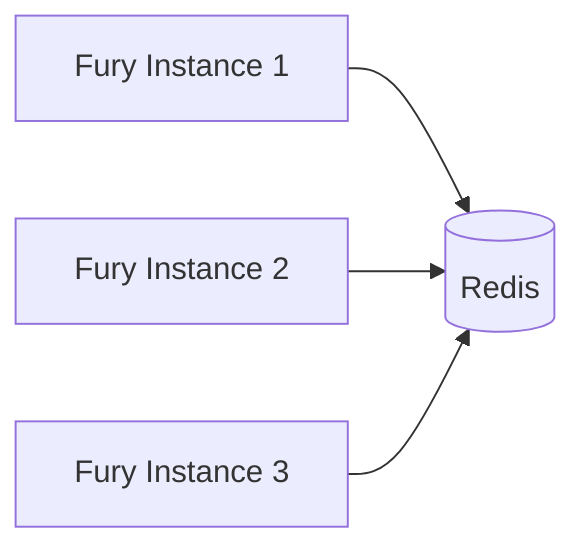

### Fury does not persist

- Assessments
- Users
- Questions
- Exam attempts
- Analytics
- Grading results
- Other business-domain entities

Those belong to the responsible domain services.

### Redis usage

The architecture specifies Redis for:

1. Rate-limit counters (token-bucket state)
2. Real-time token revocation cache / Bloom filter (for instant mid-exam revocation of flagged students)
3. Gateway-level duplicate request suppression (for idempotent mutations)

#### Production Redis Failure Policy
- **Standard Read / Query Endpoints:** Fail open, log warning, emit P1 metric alert.
- **Administrative / Authentication Actions:** Fail closed (protect security boundary).
- **CRITICAL EXAM SUBMISSION ENDPOINTS (`/attempts/:id/submit`):** **Fail OPEN to Stark/Downstream.** In high-stakes examinations, if Redis becomes temporarily unreachable, Fury must never discard student submissions with a 500/503. Stark enforces business-level idempotency and transactional uniqueness on `(attemptId, idempotencyKey)` in MongoDB, guaranteeing that student work is safely preserved without duplicates.

---

## 14. Security Boundary

Fury sits between the public API boundary and internal services.

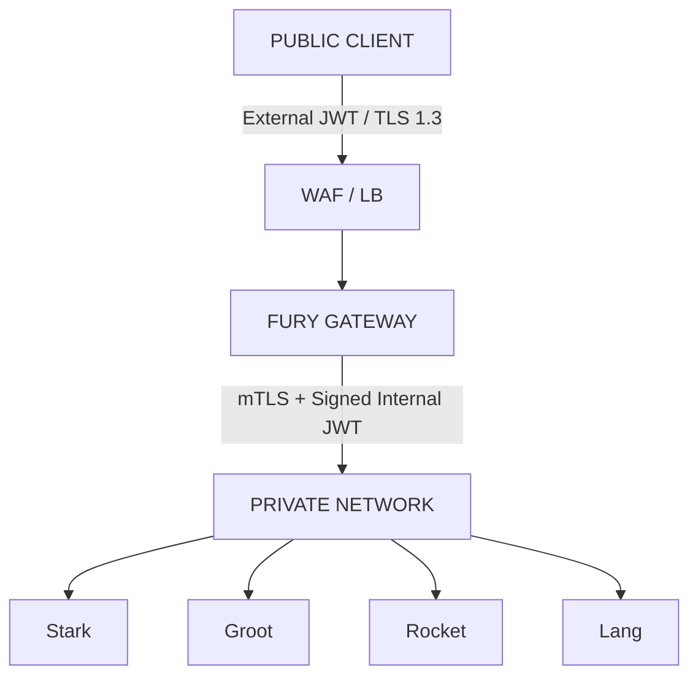

### Fury-level security controls

The architecture identifies:

- Asymmetric JWT validation via Rogers JWKS + Redis revocation verification
- CORS enforcement at edge
- Request schema validation (rejecting malformed payloads before downstream fan-out)
- API versioning and deprecation controls
- Universal response sanitization (no internal stack traces or database schema leaks)
- Request/response correlation and trace context injection (`X-Request-ID`, `traceparent`)

### Service-to-Service Zero-Trust Protocol
Fury does **not** forward external client JWTs or unverified plaintext HTTP headers (`x-user-id`, `x-tenant-id`) across the internal network. 

Instead, Fury operates as a trusted cryptographic translation boundary:
1. Fury validates the external JWT against Rogers' public keys.
2. Fury extracts the verified identity, tenant, and role claims.
3. Fury mints a short-lived (2-minute TTL), cryptographically signed **Internal Service Token** (JWT) with explicit audience pinning (e.g., `aud: "stark"`).
4. All internal HTTP calls carry this internal JWT over an mTLS-secured transport layer.

This architecture prevents internal spoofing, lateral privilege escalation, and header injection vulnerabilities across microservices.

---

## 15. Request Validation

Fury should validate gateway/API-level request requirements before forwarding requests.

Examples include:

- Required parameters
- Request body schema
- Path parameter format
- Query parameter format
- Request size constraints

Domain-specific validation remains the responsibility of the downstream domain service.

For example:

```text
Fury:
"Is assessmentId present and correctly formatted?"

Stark:
"Does this assessment exist?"
"Can this professor modify it?"
"Is this state transition allowed?"
```

---

## 16. Scalability

Fury is stateless, so multiple instances can run behind a load balancer.

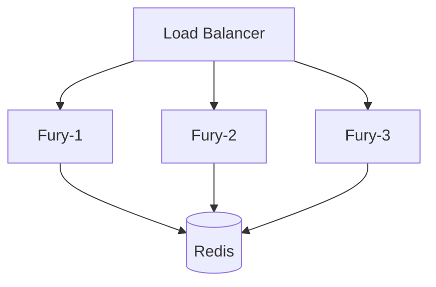

The architecture proposal specifies:

- Minimum Fury replicas: **3**
- Scaling trigger: request rate
- Scaling metrics: CPU + request rate

Because Fury does not maintain local business state, traffic can be distributed across instances.

---

## 17. Availability Considerations

A single Fury instance should not represent a single point of failure.

The deployment should therefore support:

- Multiple Fury replicas
- Load balancing
- Health checks
- Horizontal scaling
- Shared Redis access where required

Fury's stateless design makes horizontal replication straightforward.

---

## 18. Observability

Fury should provide gateway-level observability.

### Tracing

OpenTelemetry is used for distributed tracing.

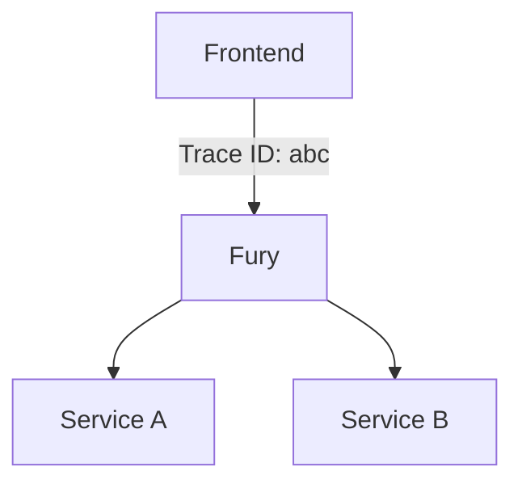

### Logging

Logs should capture useful request context such as:

- Trace/request ID
- HTTP method
- Route
- Status code
- Request duration
- Downstream service
- Downstream latency
- Error information

Sensitive credentials and tokens must not be logged.

### Metrics

Useful Fury metrics include:

- Request count
- Request latency
- Error rate
- 4xx rate
- 5xx rate
- 429 rate
- Downstream latency
- Downstream error rate
- Circuit-breaker state
- Redis operation failures
- Active requests

---

## 19. Health Checks

Fury should expose health endpoints suitable for deployment and load-balancer health checks.

Example:

```text
GET /health
```

A readiness check should represent whether the Fury instance is capable of serving traffic.

A deeper dependency check may be used separately where required, rather than making every load-balancer health check depend on every downstream service.

---

## 20. API Boundary

Fury owns the external API contract.

Example:

```text
/api/v1/assessments
/api/v1/dashboard
/api/v1/exams/:id/start
/api/v1/attempts/:id/submit
```

The internal routes used between Fury and services should remain internal.

Example:

```text
Public:
GET /api/v1/dashboard

Internal:
GET /internal/assessments?professorId=X
```

The frontend should not need to know the internal route or location.

---

## 21. Dependency Model

Fury has dependencies, but does not own the implementation of those dependencies.

| Dependency | Fury interaction |
|---|---|
| Authentication/Identity service | JWT validation/authentication context |
| Domain services | Request routing and BFF aggregation |
| Redis | Rate-limit counters and token-validation cache |
| WAF / Load Balancer | Public traffic entry and edge protection |
| OpenTelemetry | Distributed tracing |
| Internal service security | Authenticated/secured downstream communication |

Only the interaction with these dependencies is part of the Fury architecture. Their internal architectures belong in their respective service documents.

---

## 22. BFF Aggregation Pattern

Fury should aggregate only when the frontend operation genuinely requires multiple backend resources.

### Without BFF aggregation

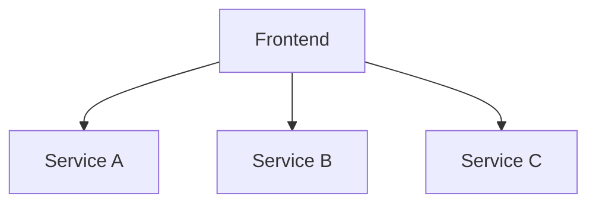

This exposes internal service boundaries to the frontend.

### With Fury BFF

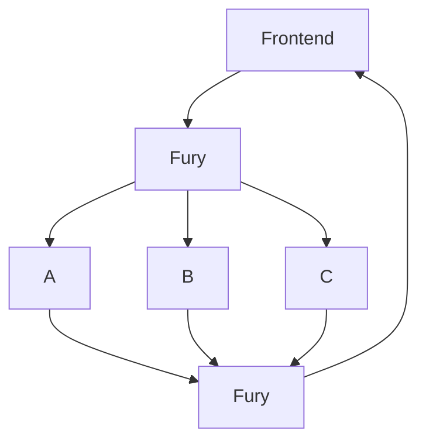

The frontend receives a single API response while Fury handles the internal fan-out.

---

## 23. Direct Frontend Exceptions

The general architecture rule is that frontend application traffic goes through Fury.

Two documented exceptions exist:

### 23.1 Proctoring WebSocket

Proctoring telemetry uses a direct WebSocket connection to Barton because the telemetry is continuous and high-frequency.

The WebSocket handshake still validates the JWT.

This is an intentional exception to the normal Fury HTTP gateway path.

### 23.2 Pre-signed Object Storage Uploads

Fury issues short-lived pre-signed URLs for object-storage uploads (curriculum documents and proctoring video chunks).

The frontend uploads directly to object storage using that URL, preserving Fury's bandwidth and event loop.

#### Upload Hardening & Anti-Abuse Controls:
1. **Header-Bound IAM Signatures:** Pre-signed URLs are cryptographically bound to specific HTTP headers:
   - Enforced `Content-Type` matching the declared MIME type (prevents executable/HTML file substitution).
   - Strict `content-length-range` (prevents storage exhaustion attacks).
   - Optional client-calculated `x-amz-checksum-sha256` validated by object storage upon write.
2. **Quarantine State Lifecycle:** Uploaded files are not immediately attached to live assessments. Upon upload completion notification (`POST /api/v1/files/:fileId/complete`), files enter a `QUARANTINED` state until Vision completes prompt-injection sanitization and malware scanning.

---

## 24. Technology Stack

| Component | Technology | Rationale / Production Role |
|---|---|---|
| Runtime | Node.js (v20 LTS) | Asynchronous I/O, event-driven concurrency |
| Language | TypeScript 5.5+ | Strict compile-time typing and contract enforcement |
| HTTP Framework | **Fastify 5.x** | High throughput (2-3x faster than Express), schema-compiled JSON serialization, async plugin lifecycle, low overhead |
| Cache / Gateway State | Redis (Cluster) | Distributed rate limiting, revocation Bloom filter, token validation cache |
| Authentication | Asymmetric JWKS + Redis Revocation | Stateless signature validation via Rogers public keys + sub-millisecond revocation lookup |
| Tracing | OpenTelemetry SDK | W3C Trace Context (`traceparent`) distributed across downstream mesh |
| API Transport | HTTPS (TLS 1.3) | Public API boundary encryption terminated at gateway/WAF |
| Public Port | 443 | Standard secure HTTP entry |
| Deployment Model | Horizontally scalable / stateless | Min 3 replicas, HPA scaling on CPU and request rate |

The architecture specifies **Node.js + Fastify 5.x + TypeScript** as Fury's technology stack to deliver sub-50ms gateway latency under 10,000+ concurrent live exam sessions.

---

## 25. Logical Components Inside Fury

The following are logical modules/responsibilities rather than separate services:

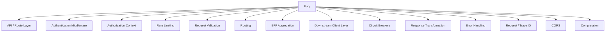

The exact source-code structure is intentionally not defined here. That belongs to the Fury LLD/project-structure documentation.

---

## 26. Example: Simple Routing Request

For a request that needs only one downstream service:

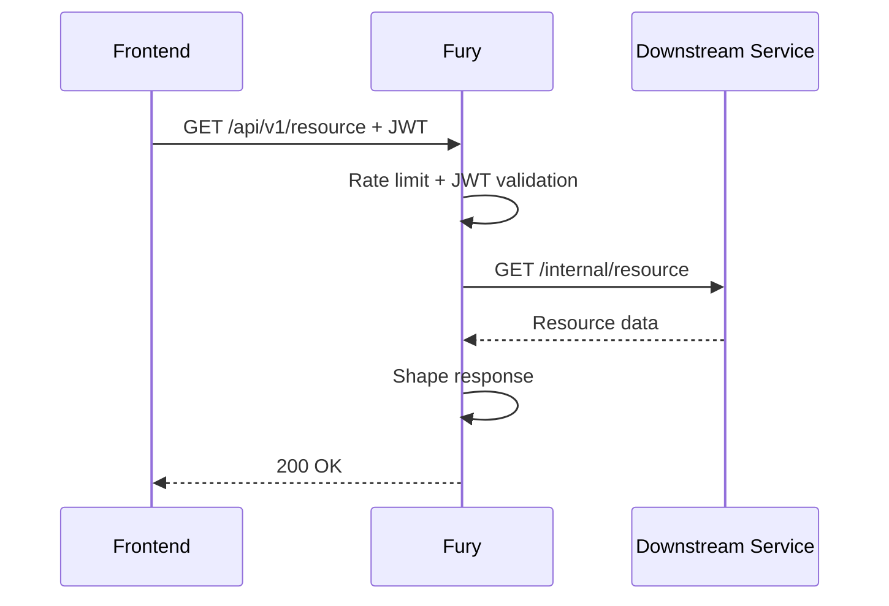

There is no aggregation because only one downstream service is required.

---

## 27. Example: Aggregated Request

```mermaid
sequenceDiagram
    participant F as Frontend
    participant FY as Fury
    participant A as Service A
    participant B as Service B

    F->>FY: GET /api/v1/dashboard + JWT
    FY->>FY: Authenticate + rate limit

    par Parallel downstream calls
        FY->>A: Request A data
        FY->>B: Request B data
    end

    A-->>FY: Response A
    B-->>FY: Response B

    FY->>FY: Aggregate responses
    FY-->>F: Unified dashboard response
```

Parallel fan-out should be used where the requested data has no dependency between the downstream calls.

---

## 28. Failure Example

If one required downstream service fails:

```mermaid
sequenceDiagram
    participant F as Frontend
    participant FY as Fury
    participant S as Downstream Service

    F->>FY: Request
    FY->>S: Internal request
    S--xFY: Timeout / unavailable
    FY->>FY: Circuit breaker handles failure
    FY-->>F: Controlled error response
```

The goal is to keep the failure contained and provide a predictable API response.

---

## 29. Architectural Constraints

Fury should preserve the following constraints:

1. Fury remains stateless.
2. Fury does not own a business database.
3. Fury does not implement business-domain logic.
4. Internal service databases are not accessed directly by Fury.
5. Public API traffic is controlled through Fury.
6. Authentication is enforced at the gateway boundary.
7. Downstream calls are protected against cascading failures.
8. Request tracing is propagated downstream.
9. BFF aggregation is used where it provides a useful frontend-facing API.
10. Fury can be horizontally scaled.

---

## 30. Resolved & Production Architecture Decisions

The following key architecture decisions have been formalized for production:

- **Gateway Runtime & Framework:** Node.js v20 LTS + Fastify 5.x + TypeScript (for schema-compiled serialization and high-throughput concurrency).
- **Public vs. Internal Token Model:** Public requests use Rogers RS256/ES256 JWKS tokens. Fury verifies public signatures statelessly with an in-memory JWKS cache, cross-checks an asynchronous Redis revocation filter, and mints short-lived (2 min) signed **Internal Service Tokens** (`aud: "<downstream-service>"`) over mTLS.
- **Flash-Crowd / Thundering Herd Strategy:** Campus NAT-aware rate limiting keyed on `(tenantId, userId)` rather than client IP. Admission queues and staggered issuance for `/exams/:id/start`.
- **Exam Submission Failure Policy:** If Redis rate-limit/idempotency cache is degraded or unavailable, `/attempts/:id/submit` **fails open to Stark/DB**, where transactional unique compound indexing guarantees zero lost submissions.
- **Object Storage Security:** Pre-signed URLs bound to declared MIME types, `content-length-range`, and SHA-256 checksums, with uploaded curriculum docs quarantined until Vision anti-malware/prompt-injection scans pass.
- **Circuit Breaker Coordination:** Multi-pod state synchronization via Redis to eliminate thundering probes upon downstream recovery.
- **Unified Response & Error Format:** Standardized universal envelope (`{ success, data, error: { code, message, details }, meta: { requestId } }`) across all endpoints.

---

## 31. Pending Dependency Contract Confirmations

The following downstream dependency details are tracked in the Dependency Contract Matrix ([`FuryAPIContract-final.md`](file:///Users/fc20396/Documents/assessVerse/docs/FuryAPIContract-final.md#L1244)):
- Exact schema payloads for Stark assessment draft / question review.
- Exact schema payloads for Groot user profiles and tenant configuration.
- Exact schema payloads for Rocket analytics exports.
- Lang admission token payload structure.
- Barton WebSocket handshake confirmation parameters.

---

## 31. Summary

Fury is the **gateway and BFF layer** of the platform.

Its responsibility can be summarized as:

```mermaid
flowchart TD
    RECEIVE[RECEIVE] --> AUTHENTICATE[AUTHENTICATE]
    AUTHENTICATE --> RATE[RATE LIMIT]
    RATE --> ROUTE[ROUTE]
    ROUTE --> ONE[One Service]
    ROUTE --> MULTI[Multiple Services]
    ONE --> RESPONSE[Response]
    MULTI --> AGG[Aggregate]
    RESPONSE --> SHAPE[SHAPE RESPONSE]
    AGG --> SHAPE
    SHAPE --> TRACE[TRACE]
    TRACE --> RETURN[RETURN TO CLIENT]
```

Fury does not become another business service. It remains a **lean, stateless gateway/orchestrator** whose job is to control the boundary between frontend requests and internal service operations.
